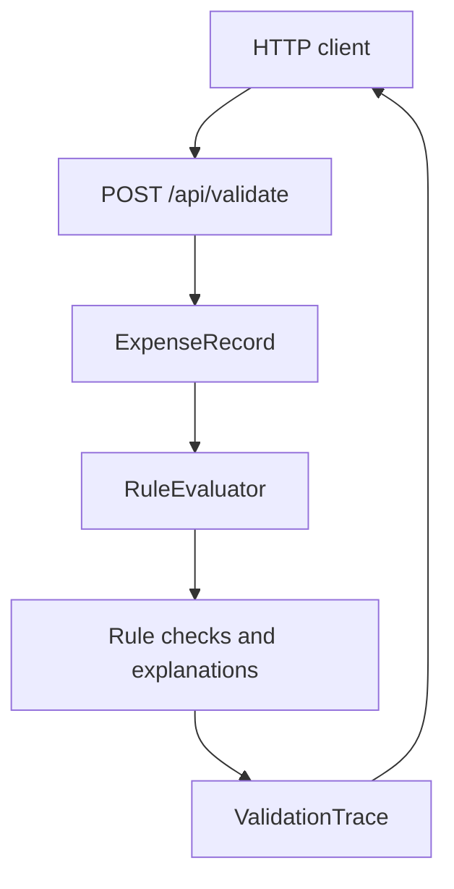

# RuleTrace architecture

## Purpose

RuleTrace demonstrates deterministic validation for a synthetic expense record and returns an overall result plus one explanation per rule.

The hosted `demo.html` is not part of this API flow. It runs a parallel example policy in browser JavaScript so the visitor can interact without a public API deployment.

## Responsibilities

- `Program.cs`: application startup, URL configuration and HTTP routes.
- `ExpenseRecord.cs`: request contract.
- `RuleEvaluator.cs`: deterministic rule evaluation.
- `RuleCheck.cs`: result types.
- `RuleEvaluatorTests.cs`: direct unit coverage of representative outcomes.

## Design decisions

1. Keep evaluation separate from transport so rules can be tested directly.
2. Return stable rule IDs to avoid parsing prose to identify failures.
3. Make the sample policy deterministic and synthetic.
4. Keep the browser demo separate so it does not imply a hosted API exists.

## Current boundaries

There is no authentication, authorisation, persistence, configurable policy store, rate limiting, structured telemetry or deployment. Before production use, request validation, error responses, operational telemetry, access control and a deployment threat model would need to be designed and tested. This is not a general-purpose rules engine.
